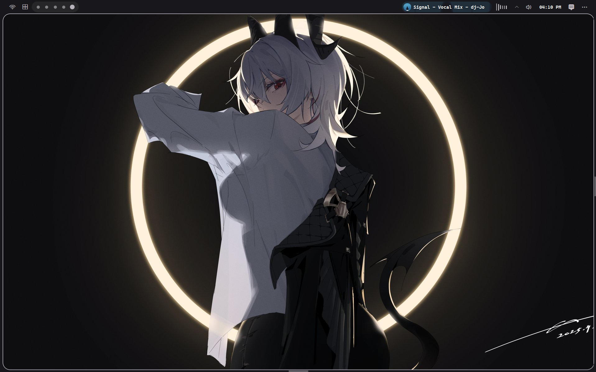
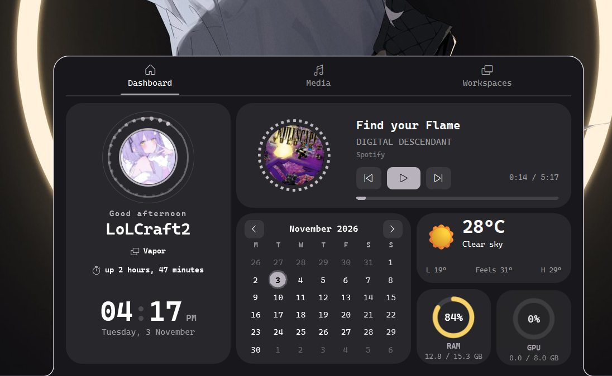
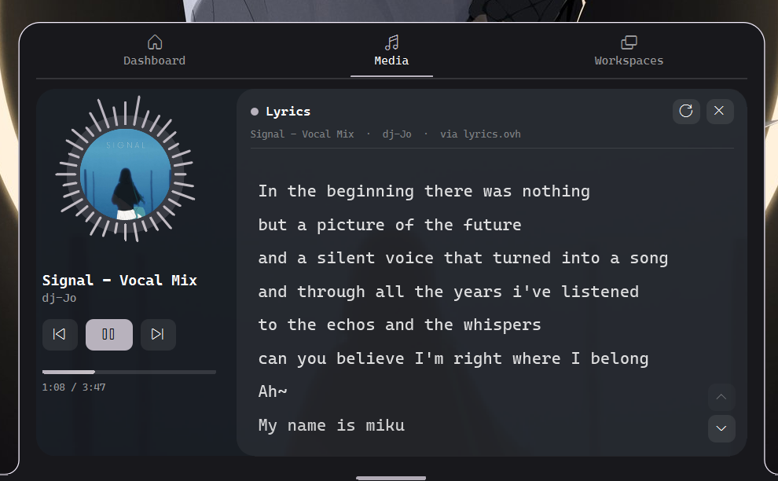
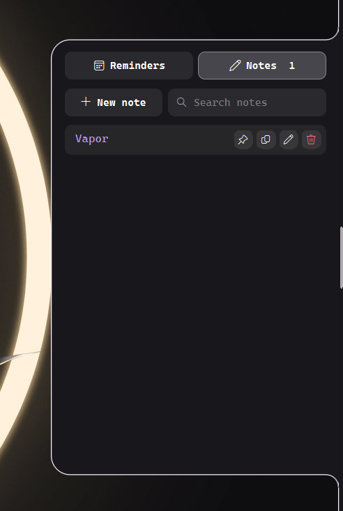
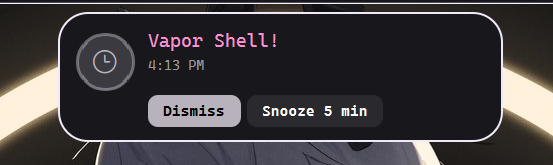
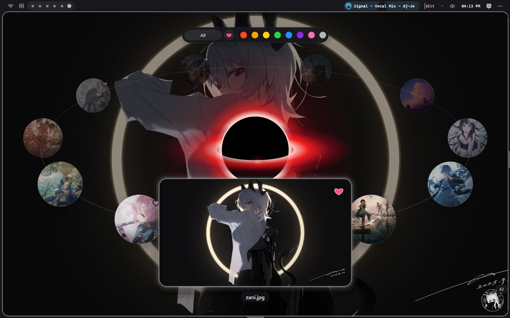
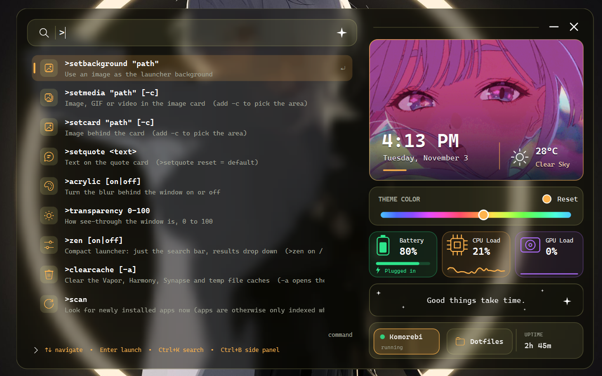

<p align="center">
  
</p>

<h1 align="center">Vapor</h1>

<p align="center">A Linux-like shell for Windows.<br>Python + PySide6 + QML.</p>

<p align="center"><b>Closed beta testing</b></p>



Vapor is a desktop shell for Windows. You get a rounded bar across the top, a glass frame around the screen, a side panel and a control center. I built it around my own colours, but it follows your wallpaper and has a theme you can change from the control center.

It's a hobby project and it's in closed beta, so it works on my machine and you should expect some rough edges.

> **New:** two companion apps are out, **Harmony** (wallpaper selector) and **Synapse** (app launcher). More on them [below](#harmony-and-synapse).

## What you get

- A top bar with your open apps, system tray, clock, workspace dots (if you use komorebi), volume, Wi-Fi and so on
- Its own reserved screen space, like a real taskbar, so windows never go underneath it
- A side panel with reminders, notes and a timer
- A control center with Wi-Fi, Bluetooth, volume mixer, system stats, theme colours and a power menu
- A media widget with album art and an audio visualizer
- Weather, uptime, your profile picture and name
- Colours picked up from your wallpaper
- `vaporctl`, a command line tool that controls all of it from any terminal

Some widgets need optional packages (media, visualizer, volume). If one is missing, only that widget turns off and the rest keeps working.

<details>
  <summary><b>Widgets Preview</b></summary>
  <br>
  <table>
    <tr>
      <td valign="top">
        
      </td>
      <td valign="top">
        
      </td>
      <td valign="top">
        
      </td>
      <td valign="top">
        
      </td>
    </tr>
  </table>
</details>

## Before you install

Vapor runs on Windows 10 or 11 with PowerShell. There are two other tools I'd like you to have.

### Komorebi (recommended)

[Komorebi](https://github.com/LGUG2Z/komorebi) is a tiling window manager for Windows. Vapor is mainly made to be used with komorebi, and the workspace dots in the bar come from it. You don't need it though. Vapor works perfectly fine without it.

Get it from the [official komorebi repository](https://github.com/LGUG2Z/komorebi).

### Everything (a must)

[Everything](https://www.voidtools.com/) by voidtools is an instant file search for Windows. Please install it. Synapse relies on Everything's file index to search your files quickly, so it's a must.

Download it from the [official voidtools website](https://www.voidtools.com/).

## Install

### 1. Pick where it goes

Open PowerShell and go to the folder you want Vapor in. The installer creates a `Vapor` folder inside the folder you're in, so nothing else in there gets touched.

```powershell
cd D:\Apps
```

### 2. Run the installer

```powershell
irm https://raw.githubusercontent.com/LoLCraft2L/Vapor-Shell/main/scripts/install.ps1 | iex
```

It downloads the latest release, installs it into `D:\Apps\Vapor` (or wherever you were), adds a Start Menu shortcut and starts Vapor. On a first install it also asks whether you want [Harmony and Synapse](#harmony-and-synapse).

Want it to start when you log in? Run `vaporctl autostart on` once Vapor is installed.

### Choose the extras without being asked

Add `-Extras Harmony,Synapse` to install them without the question, or `-NoExtras` to skip it:

```powershell
& ([scriptblock]::Create((irm https://raw.githubusercontent.com/LoLCraft2L/Vapor-Shell/main/scripts/install.ps1))) -Extras Harmony,Synapse
```

### Install into a specific folder

Use `-Dir` if you don't want to `cd` first. Point it at an empty or new folder:

```powershell
& ([scriptblock]::Create((irm https://raw.githubusercontent.com/LoLCraft2L/Vapor-Shell/main/scripts/install.ps1))) -Dir "D:\Apps\Vapor"
```

The installer refuses a folder that already has other files in it and no `Vapor.exe`. Installing clears the folder it installs into (your `config.json` and `files` folder are kept), so this stops you from wiping something by accident.

### Update

```
vaporctl update
```

That installs the newest release and leaves your `config.json` and `files` folder alone. Harmony and Synapse get updated too if you have them installed. Use `vaporctl update --check` if you only want to see whether something new is out.

### Uninstall

```
vaporctl uninstall
```

This removes the app folder, the shortcuts and the PATH entry. Your logs and settings in `%LOCALAPPDATA%\vapor` are kept.

## Using it

- **Alt+W** closes Vapor (start it again from the Start Menu or with `vaporctl start`)
- Everything else is clickable. The control center and side panel open from the bar.

To hide the bar without closing Vapor, use `vaporctl hide` and `vaporctl show`. For anything else, there's `vaporctl`.

## vaporctl

`vaporctl` is a small command line tool that controls Vapor from any terminal. It's added to your PATH the first time Vapor starts, so **open a new terminal after the first start** (PATH changes only show up in new windows).

Most commands also work when Vapor isn't running. `vaporctl start` launches it, and things like volume, media, timers, reminders and notifications do their job directly if the shell is down.

Run `vaporctl` with no arguments any time to see the full list. Here's the short version.

### Try these first

```
vaporctl status       # volume, battery, Wi-Fi, media, workspace, bar state
vaporctl fetch        # logo + version + live status in one coloured card
vaporctl --version    # which version you have
vaporctl doctor       # checks your install, config and log for problems
```

### Running Vapor

| Command | What it does |
| --- | --- |
| `vaporctl start` | Start Vapor (does nothing if it's already running) |
| `vaporctl restart` | Restart it |
| `vaporctl quit` | Close it (`stop` does the same, and `stop --force` kills a hung copy) |
| `vaporctl autostart on` / `off` | Start Vapor at every login |
| `vaporctl update` | Install the latest release (`--check` only looks, `--force` reinstalls the same version) |
| `vaporctl update --extras --force` | Asks again which optional packages to install (Harmony, Synapse). `--force` is needed when you're already on the latest version |
| `vaporctl uninstall` | Remove Vapor (your logs and settings are kept) |
| `vaporctl hide` / `show` / `toggle` | Slide the bar away or bring it back |
| `vaporctl reload` | Re-read `config.json` without restarting |

### Making it yours

| Command | What it does |
| --- | --- |
| `vaporctl setname "Your Name"` | Set the name on the profile card (`--reset` goes back to your Windows name) |
| `vaporctl pfp C:\pics\me.png` | Set your profile picture (the file is copied into `files`), or `pfp reset` |
| `vaporctl set location Pokhara` | Set the weather place. `"Paris, France"`, `"27.7,85.3"` and `auto` (from your IP) all work. Add `--f` or `--c` for the unit |
| `vaporctl wallpaper random` | Set a wallpaper. Also takes a file path, `next`, `prev`, or `dir <folder>` to choose the folder |
| `vaporctl ringtone C:\sounds\alarm.mp3` | Replace the alarm sound (copied to `files\ringtone.mp3`). `ringtone test` plays it once |

### Sound and media

```
vaporctl volume 40        # set to 40%
vaporctl volume +10       # step up (or -10 to step down)
vaporctl mute             # toggle mute (or: mute on / mute off)
vaporctl media            # what's playing right now
vaporctl media next       # also: play, prev
```

### Reminders, timers and notes

```
vaporctl timer 25m                         # also 1h30m, 90 (seconds), or "cancel"
vaporctl remind 18:30 "Call mom"           # also 7pm, 7:30pm, 10m, 1h30m
vaporctl remind 9am "Standup" --every daily    # or weekly, monthly
vaporctl reminders                         # list reminders and the running timer
vaporctl reminders rm 2                    # remove reminder number 2

vaporctl note "Buy milk" -t "Shopping"     # add a note with a title
vaporctl note                              # list your notes
vaporctl note show 1                       # read note number 1
vaporctl note rm 1                         # delete it
echo hello | vaporctl note -               # read the note text from stdin
```

### Alerts and notifications

```
vaporctl alert "Tea is ready" "Don't let it get cold"   # in-bar card + ringtone
vaporctl dismiss                                         # dismiss it / stop the ringtone
vaporctl notify "Build done"                             # a normal Windows toast
```

### Komorebi

```
vaporctl ws 2          # switch to workspace 2 (also: next, prev)
vaporctl layout next   # cycle the layout (also: prev)
```

### When something's wrong

| Command | What it does |
| --- | --- |
| `vaporctl log` | Show the last 40 lines of the log (`vaporctl log 100` for more) |
| `vaporctl paths` | Where your config, files, log and settings live |
| `vaporctl config` / `vaporctl files` | Open `config.json` / the `files` folder |
| `vaporctl config get` | Show every config key (or `config get <key>` for one) |
| `vaporctl config set <key> <value>` | Change one key without opening the file (`config unset <key>` removes it) |
| `vaporctl doctor --report` | Checks everything and adds the log tail and your config. Paste this when you report a bug |

Add `--json` to any command if you want the raw reply for scripts.

## Settings

There's a `config.json` next to `Vapor.exe`. It gets created on first start.

```json
{
  "userName": "",
  "profilePicture": "",
  "addToPath": true
}
```

- `userName`: leave empty to use your Windows account name
- `profilePicture`: a full path, or a file name inside the `files` folder. Empty means your Windows account picture
- `addToPath`: Vapor adds its folder to your user PATH so `vaporctl` works anywhere. Set it to `false` if you don't want that

You can edit the file by hand, or use `vaporctl config set`. Put a `ringtone.mp3` in `files` if you want your own timer sound.

## Harmony and Synapse


Two apps made to go with Vapor have been released. I designed both of them.

- **Harmony** is my wallpaper selector.
- **Synapse** is an app launcher with commands that can control Vapor. It uses Everything for file search, so make sure you have [Everything](https://www.voidtools.com/) installed.

They're optional. The installer asks if you want them the first time you install Vapor. They live in the `extras` folder inside your Vapor folder, so updating Vapor never wipes them. A normal `vaporctl update` keeps them up to date once they're installed, and `vaporctl update --extras --force` asks again which ones you want.

<details>
  <summary><b>Preview</b></summary>
  <br>
  <table>
    <tr>
      <td valign="top">
        
      </td>
      <td valign="top">
        
      </td>
    </tr>
  </table>
</details>

## Running from source

You need Python 3.10+ on Windows.

```
pip install -r requirements.txt
pythonw vapor.pyw
```

Use `python vapor.pyw` instead if you want to see errors in the console. `--no-appbar` stops it from reserving screen space, which is handy while testing.

Errors go to `%LOCALAPPDATA%\vapor\vapor.log`, and QML errors end up there as well. Check it first if something doesn't start (`vaporctl log` shows it too).

## Building the exe

```
.\scripts\build.ps1
```

That makes `dist\Vapor\Vapor.exe` and `dist\Vapor-win64.zip`. To publish a version, create a GitHub release with a tag like `v0.1.0` and attach `Vapor-win64.zip`. The install command always grabs the newest published release, so don't mark it as a pre-release or the installer won't find it.

## Known problems

- Windows only
- Closed beta, so bugs are expected
- The exe isn't code signed. Some antivirus programs don't like unsigned PyInstaller apps and may flag it. The source is all here, and you can build it yourself

## Credits

I designed Vapor, Harmony and Synapse myself. The code for Vapor was written by Claude (an AI assistant made by Anthropic), and I did some small debugging myself.

Heavily inspired by Caelestia, and YASB was the main help when it came to designing it.
