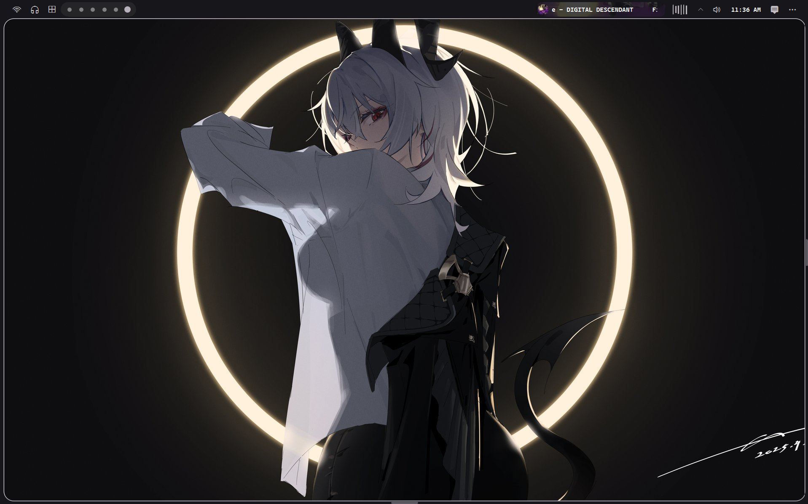
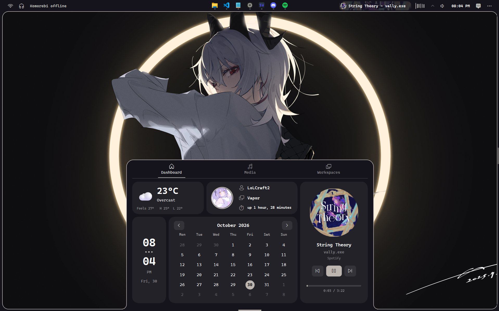

<p align="center">
  
</p>

<h1 align="center">Vapor</h1>

<p align="center">A linux like shell for Windows.<br>Python + PySide6 + QML.</p>

<p align="center"><b>v0.1.0 &middot; closed beta testing</b></p>



Vapor is a desktop shell for Windows: a rounded bar across the top, a glass frame around the screen, a side panel and a control center. It was built around my own colours, but the whole thing follows your wallpaper and a theme you can change from the control center.

It's a hobby project and it's in closed beta right now. It works on my machine, so expect rough edges.

## What's in it

- Top bar with your open apps, system tray, clock, workspace dots (if you use komorebi), volume, Wi-Fi and so on
- Reserves its own screen space like a real taskbar, so windows don't go underneath it
- Side panel with reminders, notes and a timer
- Control center: Wi-Fi, Bluetooth, volume mixer, system stats, theme colours, power menu
- Media widget with album art and an audio visualizer
- Weather, uptime, your profile picture and name
- Colours picked up from your wallpaper
- `vaporctl`, a small command line tool to control it from any terminal

Some widgets need optional packages (media, visualizer, volume). If one is missing, only that widget is disabled and the rest keeps working.

## Install

Windows 10 or 11 and PowerShell. Nothing else to set up.

### 1. Pick where it goes

Open PowerShell and go to the folder you want Vapor in. The installer creates a `Vapor` folder inside the folder you are in, so nothing else in there gets touched.

```powershell
cd D:\Apps
```

### 2. Run the installer

```powershell
irm https://raw.githubusercontent.com/LoLCraft2L/Vapor-Shell/main/scripts/install.ps1 | iex
```

It downloads the latest release, installs it into `D:\Apps\Vapor` (or wherever you were), adds a Start Menu shortcut and starts Vapor.

### Start Vapor when you log in

Add `-AutoStart`. This form of the command (a script block) is also what you use for every other option:

```powershell
& ([scriptblock]::Create((irm https://raw.githubusercontent.com/LoLCraft2L/Vapor-Shell/main/scripts/install.ps1))) -AutoStart
```

### Install into a specific folder

Use `-Dir` if you don't want to `cd` first. Point it at an empty or new folder:

```powershell
& ([scriptblock]::Create((irm https://raw.githubusercontent.com/LoLCraft2L/Vapor-Shell/main/scripts/install.ps1))) -Dir "D:\Apps\Vapor"
```

The installer refuses a folder that already has other files in it and no `Vapor.exe`, because installing clears the folder it installs into (your `config.json` and `files` folder are kept).

### Update

Run the install command again from the same folder you installed from (for example `D:\Apps`), or pass the same `-Dir`. Your `config.json` and `files` folder are left alone.

If you run it from a different folder, you get a second copy there and the Start Menu shortcut moves to it.

### Uninstall

Run the same script with `-Uninstall`:

```powershell
& ([scriptblock]::Create((irm https://raw.githubusercontent.com/LoLCraft2L/Vapor-Shell/main/scripts/install.ps1))) -Uninstall
```

Run it from the folder you installed from. If it can't find Vapor there, it follows the Start Menu shortcut to wherever you installed. It removes the app folder, the shortcuts and the PATH entry. Your logs and settings in `%LOCALAPPDATA%\vapor` are kept.

## Using it

- **Alt+W** hides and shows the bar
- Everything else is clickable, the control center and side panel open from the bar

### Settings

There's a `config.json` next to `Vapor.exe`. It gets created on first start.

```json
{
  "userName": "",
  "profilePicture": "",
  "addToPath": true
}
```

- `userName`: leave empty to use your Windows account name
- `profilePicture`: a full path, or a file name inside the `files` folder. Empty means your Windows account picture
- `addToPath`: Vapor adds its folder to your user PATH so `vaporctl` works anywhere. Set to `false` if you don't want that

Put a `ringtone.mp3` in `files` if you want your own timer sound.

### vaporctl

```
vaporctl set location <place>    weather location
vaporctl restart
vaporctl quit
```

Notes and reminders can be added from there too. Run `vaporctl` with no arguments to see everything it knows. Open a new terminal after the first start, since PATH changes only show up in new windows.

## Running from source

You need Python 3.10+ on Windows.

```
pip install -r requirements.txt
pythonw vapor.pyw
```

Use `python vapor.pyw` instead if you want to see errors in the console. `--no-appbar` stops it from reserving screen space, handy while testing.

Errors go to `%LOCALAPPDATA%\vapor\vapor.log`, and QML errors end up there as well. Check it first if something doesn't start.

## Building the exe

```
.\scripts\build.ps1
```

That makes `dist\Vapor\Vapor.exe` and `dist\Vapor-win64.zip`. To publish a version, create a GitHub release with a tag like `v0.1.0` and attach `Vapor-win64.zip`. The install command always grabs the newest published release, so don't mark it as a pre-release or the installer won't find it.

## Known problems

- Windows only
- Closed beta, so bugs are expected
- The exe isn't code signed. Some antivirus programs don't like unsigned PyInstaller apps and may flag it. The source is all here, and you can build it yourself

## Credits

Heavily inspired by Caelestia, and YASB was the main help when it came to designing it.
